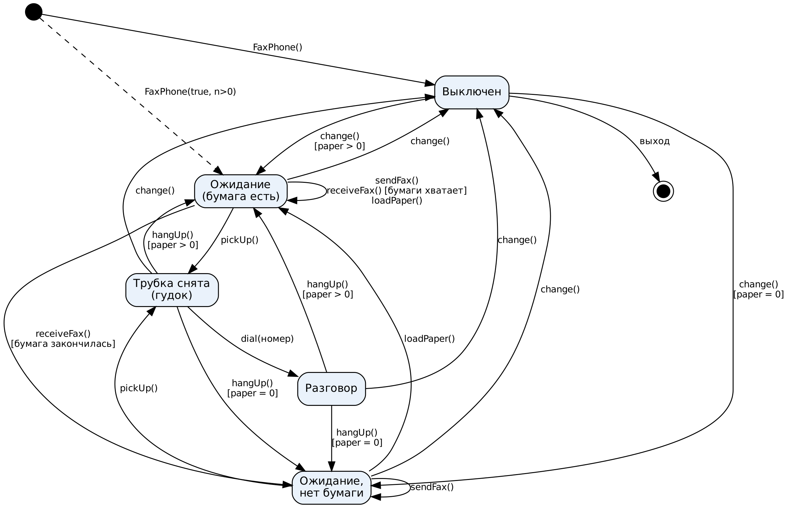

# S3P13 Моделирование устройств с помощью класса — вариант 14 «Телефон-факс»

Исполнитель: Нестеренко М. (ИКТГ-2521)

Класс `FaxPhone` моделирует работу телефона-факса.

Свойства (private):

| Свойство | Тип | Допустимые значения |
|---|---|---|
| `power` — питание | bool | вкл / выкл |
| `handsetUp` — трубка | bool | снята / положена |
| `connected` — соединение | bool | есть / нет |
| `paper` — бумага в лотке | int | 0..50 |

Методы (public): `change()` (вкл/выкл), `pickUp()`, `hangUp()`, `dial(номер)`,
`sendFax(страниц)`, `receiveFax(страниц)`, `loadPaper(листов)`, `show()`.

Состояния: Выключен, Ожидание, Ожидание — нет бумаги, Трубка снята (гудок), Разговор.



Сборка и запуск:

```
g++ main.cpp FaxPhone.cpp -o lab && ./lab
g++ tests.cpp FaxPhone.cpp -o tests && ./tests
```
